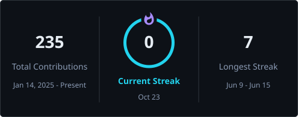

## About

**Most of what I know about software, I learned from things I built wrong first.**

I'm a Computer Science undergraduate at RGMCET, Nandyal (graduating 2027, CGPA 9.47/10), focused on backend and full-stack engineering. I've moved past tutorials: two internships and four projects later, I've worked with REST APIs, authentication, role-based access control, databases, and real-time features.

I work mostly in Java with Spring Boot and in Node.js with Express, use React on the front end, and practice DSA in Java on LeetCode.

I'm looking for an opportunity to contribute to real-world software, learn from experienced engineers, and let my work make the case.

## Experience

**AI Automation & Systems Intern, Modern Mint** (Apr 2026 – Jun 2026)
- Built Claude Cowork automations using prompt engineering, scheduled to run every Monday.
- Collected data from 100+ prospective users interested in board games.
- Contributed to authentication, landing-page functionality, and Phase 1 product features.

**Java Full Stack Developer Intern, Infosys Springboard** (Nov 2025 – Jan 2026)
- Built SiteSurvey Pro, a multi-tier ISP site-survey application using Spring Boot, React, PostgreSQL, and JWT.
- Developed 15+ REST APIs for properties, buildings, floors, spaces, and checklists.
- Implemented JWT authentication, role-based access control, password hashing, request validation, and Controller–Service–Repository architecture.

## Projects

### SkillSwap: Real-Time Peer Learning Platform

A peer-to-peer skill-exchange platform with real-time chat and browser-based video sessions.

     

- Real-time chat and video sessions using Socket.io and the Jitsi Meet SDK.
- Accounts secured with JWT authentication and bcrypt password hashing.

[**Live demo**](https://skillswap-connect.netlify.app/) · [**Source code**](https://github.com/BharathiTech7/skillswap-platform)

### DocSpot: Healthcare Appointment System

A healthcare appointment booking system for patients, doctors, and administrators.

   

- 15+ REST APIs covering authentication, scheduling, availability, and admin workflows.
- Role-based access control for patients, doctors, and administrators.
- Tested with 50+ test users and 100+ appointment requests.

[**Live demo**](https://docspot-web.netlify.app/) · [**Source code**](https://github.com/BharathiTech7/Docspot)

### SiteSurvey Pro: ISP Site Survey Application

A multi-tier application for internet service provider site surveys, developed as part of my Infosys Springboard internship.

     

- APIs for managing properties, buildings, floors, spaces, and checklists.
- Secure authentication and role-based authorization.

[**Source code**](https://github.com/BharathiTech7/site-survey-tool-infosys-springboard)

### College Enquiry Chatbot

A chatbot web application that answers college admission, course, and campus-related queries.

  

- Flask API endpoints for admissions, course, and campus-facility queries.
- Gemini API integration with structured prompts for institution-specific responses.

[**Live demo**](https://college-enquiry-chatbot-qgo6.onrender.com/) · [**Source code**](https://github.com/BharathiTech7/College-Enquiry-Chatbot)

## Tech Stack

| Area | Technologies |
| :-- | :-- |
| **Languages** |       Also: C, SQL |
| **Backend** |        REST APIs, JWT, RBAC, WebSockets and Socket.io, JPA/Hibernate |
| **Frontend** |     |
| **Databases** |    |
| **Cloud & Tools** |        npm, Render, Vercel, Netlify |
| **Core CS** | Data Structures and Algorithms, OOP, DBMS, Operating Systems, Computer Networks |

## Achievements

  

- **Amazon ML Summer School 2026:** selected among 31,821 candidates from 134,421 registrants in the selection test.
- **AWS Certified Cloud Practitioner** (Amazon Web Services) and **Agile Scrum in Practice** (Infosys Springboard).
- **CGPA 9.47/10** in B.Tech Computer Science and Engineering.

## Leadership

- **In-Charge, Cre8 Club**
- **Treasurer, IEEE Computer Society Student Chapter**

These roles keep me working with people as much as with code: collaborating, taking responsibility, and learning in a community of student technologists.

## GitHub Activity

Cards below are generated by GitHub Actions and refresh daily.

  
  

  

  <picture>
    <source media="(prefers-color-scheme: dark)" srcset="https://raw.githubusercontent.com/BharathiTech7/BharathiTech7/output/github-snake-dark.svg" />
    <source media="(prefers-color-scheme: light)" srcset="https://raw.githubusercontent.com/BharathiTech7/BharathiTech7/output/github-snake.svg" />
    
  </picture>

## Connect

I'd like to connect with engineers, recruiters, and teams working on real-world software. LinkedIn is the best way to reach me.

*Tutorials teach syntax. Shipping teaches engineering.*

